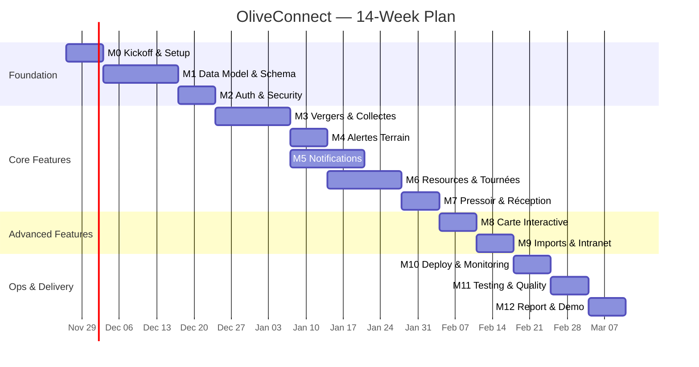

# 🫒 OliveConnect — Project Milestones

> **Team:** Jahha (Backend) · Sof (Data + Backend) · Fedi (Frontend & Server)
> **Stack:** Spring Boot · MongoDB · React + Tailwind · OAuth2 Google · Mapbox · Swagger

> [!NOTE]
> Tasks are numbered in execution order within each milestone. When a task depends on another developer's work, it is marked with **→ after [name] #N**.

---

## Milestone 0 — Kickoff & Setup *(Week 1)*

**Jahha:**
1. ☐ Create Git repo and define branching strategy (main / dev / feature branches)
2. ☐ Initialize Spring Boot project with Maven, add MongoDB & Spring Security dependencies
3. ☐ Configure Google OAuth2 credentials in Google Cloud Console

**Sof:**
1. ☐ Set up MongoDB Atlas or local instance, create `oliveconnect` database
2. ☐ Define coding conventions document and commit message format
3. ☐ Set up Swagger (springdoc-openapi) in Spring Boot → after Jahha #2

**Fedi:**
1. ☐ Initialize React + Tailwind CSS project with routing and layout shell
2. ☐ Obtain Mapbox API token and test basic map render in React

**✅ Exit:** Both apps build and run, MongoDB connected, Google OAuth2 credentials created, Swagger UI accessible, Mapbox renders.

---

## Milestone 1 — Data Model & Schema *(Weeks 2–3)*

**Sof:**
1. ☐ Create UML class diagram (Utilisateur, Verger, DemandeRecolte, Alerte, Tournée, Ressource, Affectation, Pressoir, Réception, Notification, MesureExterne)
2. ☐ Define MongoDB collections: `users`, `vergers`, `demandes`, `alertes`, `tournees`, `ressources`, `affectations`, `pressoirs`, `receptions`, `notifications`, `mesures_externes`
3. ☐ Document transformation rules from UML to MongoDB (embedding vs referencing decisions)
4. ☐ Create indexes: geospatial on vergers, compound on affectations (ressource + créneau), text on alertes
5. ☐ Create seed data files: `reference.json` (vergers, ressources, pressoirs) and `dynamic.json` (météo, maturité, capacité)

**Jahha:**
1. ☐ Set up project folder structure: `controller/`, `service/`, `repository/`, `model/`, `dto/`, `security/`, `notification/`, `integration/`, `config/`
2. ☐ Create Spring Data MongoDB entities (`@Document`) for all domain objects → after Sof #3
3. ☐ Create DTOs and Swagger-documented request/response objects for F1 endpoints → after #2

**Fedi:**
1. ☐ Build reusable UI component library (buttons, forms, tables, modals) with Tailwind
2. ☐ Set up Axios HTTP client with JWT interceptor for all API calls

**✅ Exit:** Class diagram done, all MongoDB collections created with indexes, all entities compile, seed data ready, Swagger shows DTO schemas, UI components ready.

---

## Milestone 2 — Authentication & Security *(Week 4)*

**Jahha:**
1. ☐ Integrate Spring Security OAuth2 Resource Server with Google as OIDC provider
2. ☐ Implement JWT token validation and extract user roles from token/database
3. ☐ Implement role-based method security (`@PreAuthorize`) on all controllers → after #2

**Sof:**
1. ☐ Create `users` collection schema with roles: VISITEUR, AGRICULTEUR, RESPONSABLE_COLLECTE, CHEF_EQUIPE, RESPONSABLE_LOGISTIQUE, RESPONSABLE_PRESSOIR, ADMIN
2. ☐ Build `UserRepository` — findByEmail, findByRole, save → after #1
3. ☐ Build `UserService` — registration, role assignment, profile lookup → after #2 and Jahha #2
4. ☐ Test: farmer cannot access another farmer's data (API returns 403) → after Jahha #3

**Fedi:**
1. ☐ Build login page with "Sign in with Google" button
2. ☐ Build registration page (request account, choose role)
3. ☐ Store and forward OAuth2 access token on every API call from React → after Jahha #1
4. ☐ Implement role-based menu/navigation — hide unauthorized sections in UI → after #3

**✅ Exit:** Google login works end-to-end, JWT validated, roles enforced on backend and reflected in UI, unauthorized access returns 403.

---

## Milestone 3 — F1: Vergers & Collectes *(Weeks 5–6)*

**Jahha:**
1. ☐ `VergerController` — POST create, GET list (own), GET by id, PUT update
2. ☐ `VergerService` — ownership check (farmer sees only their own), field validation (superficie ≥ 0, coordinates valid)
3. ☐ `DemandeRecolteController` — POST create (planifiée/urgente), GET list, PUT modify, PUT cancel → after Sof #2
4. ☐ `DemandeRecolteService` — status transitions: NOUVELLE → PLANIFIÉE → EN_COURS → TERMINÉE / ANNULÉE; refuse modify/cancel after EN_COURS
5. ☐ Swagger: document all F1 endpoints with examples → after #4

**Sof:**
1. ☐ `VergerRepository` — Spring Data MongoDB queries: findByProprietaire, geospatial near
2. ☐ `DemandeRecolteRepository` — queries: findByAgriculteur, findByStatut, findByVerger → after #1
3. ☐ Test: full nominal path — farmer creates verger → declares harvest → responsable sees the demand → after Jahha #4

**Fedi:**
1. ☐ "Mes vergers" page — list, add form (nom, localisation, superficie, variété), detail view → after Jahha #1
2. ☐ Form validation and error display for verger and récolte forms
3. ☐ "Récoltes" page — declare form (verger select, date, planifiée/urgente, motif), status tracker, modify/cancel buttons → after Jahha #3

**✅ Exit:** Verger CRUD working with ownership, harvest lifecycle complete, modification/cancellation enforced, Swagger docs updated.

---

## Milestone 4 — F2: Alertes Terrain *(Week 7)*

**Sof:**
1. ☐ MongoDB: `2dsphere` index on alertes collection
2. ☐ `AlerteRepository` — geospatial query, findByStatut, findByVerger → after #1
3. ☐ `AlerteService` — status transitions: NOUVELLE → EN_COURS → TRAITÉE; link alert to verger → after #2

**Jahha:**
1. ☐ `AlerteController` — POST create, GET list (by role), PUT update status → after Sof #3
2. ☐ Swagger: document all F2 endpoints → after #1

**Fedi:**
1. ☐ Browser Geolocation API — auto-detect position, fallback to manual coordinate input
2. ☐ "Alertes" page — farmer creates (type: maturité/problème, description, location), responsable treats → after Jahha #1
3. ☐ Alert status badges and filtering UI → after #2

**✅ Exit:** Alerts created with geolocation, treated by responsable, full status lifecycle working.

---

## Milestone 5 — Notifications System *(Weeks 7–8)*

**Jahha:**
1. ☐ Define Spring application events: `CollectePlanifieeEvent`, `AlerteCreeeEvent`, `TourneeAffecteeEvent`, `ReceptionConfirmeeEvent`
2. ☐ Implement `ApplicationEventPublisher` in business services to publish events → after #1
3. ☐ Implement `@EventListener` in `NotificationListener` — create and persist notification in MongoDB → after #2

**Sof:**
1. ☐ `NotificationRepository` — findByDestinataireAndLuFalse, markAsRead, findByDestinataire
2. ☐ `NotificationController` — GET unread, PUT mark-as-read, GET history → after #1 and Jahha #3
3. ☐ Test: business event → notification persisted → visible on next poll → mark as read works → after #2

**Fedi:**
1. ☐ Notification bell icon with unread count badge in navbar
2. ☐ Notification dropdown — list unread, click to mark read, link to related object → after Sof #2
3. ☐ Implement 30-second polling from React to fetch new notifications → after #2

**✅ Exit:** Notifications auto-generated on key events, persisted in MongoDB, polled every 30s, badge + dropdown working.

---

## Milestone 6 — F3: Ressources & Tournées *(Weeks 8–9)*

**Sof:**
1. ☐ `AffectationRepository` — compound index on (ressource, début, fin), overlap query
2. ☐ `TourneeRepository` — findByChefEquipe, findByDate, findByVerger → after #1
3. ☐ `RessourceService` — create, update état, list by catégorie and disponibilité → after #1

**Jahha:**
1. ☐ `RessourceController` — CRUD for 4 categories: ouvrier, tracteur, benne, matériel → after Sof #3
2. ☐ `TourneeController` — POST create (date, vergers[], chef d'équipe, ressources[]), PUT update advancement → after Sof #2
3. ☐ `TourneeService` — overlap check: reject if `debutA < finB && debutB < finA` for same resource → after #2
4. ☐ Concurrency protection: use MongoDB `findAndModify` with `@Version` for optimistic locking → after #3
5. ☐ Swagger: document all F3 endpoints → after #4

**Fedi:**
1. ☐ "Ressources" page — list by category, add/edit form, availability calendar view → after Jahha #1
2. ☐ "Tournées" page — plan tour (select vergers, assign resources, pick team lead), calendar view → after Jahha #2
3. ☐ Chef d'équipe view — see assigned tours, update advancement and quantities → after #2

**✅ Exit:** Resources managed, tours planned without overlap, concurrent booking rejected, calendar views functional.

---

## Milestone 7 — Pressoir & Réception *(Week 9)*

**Sof:**
1. ☐ MongoDB: `pressoirs` and `receptions` collections with indexes
2. ☐ `PressoirService` — calculate available capacity (total − sum of pending receptions) → after #1
3. ☐ `PressoirController` — CRUD pressoirs, GET available capacity → after #2

**Jahha:**
1. ☐ `ReceptionController` — POST confirm reception (tournée, poids, qualité, date), PUT update → after Sof #3
2. ☐ `ReceptionService` — validate poids > 0, link to pressoir, update capacity → after #1
3. ☐ Test: end-to-end path — harvest request → tour planned → team tracks → pressoir receives with poids & qualité → after #2

**Fedi:**
1. ☐ "Pressoirs" page — list pressoirs, view capacity bar, confirm reception form (poids, qualité) → after Sof #3
2. ☐ Swagger: document pressoir & reception endpoints → after Jahha #1

**✅ Exit:** Multiple pressoirs managed, reception recorded with weight and quality, full harvest lifecycle complete.

---

## Milestone 8 — F4: Carte Interactive *(Week 10)*

**Sof:**
1. ☐ MongoDB: optimized aggregation query for map data (verger + latest maturité + rendement)
2. ☐ `CarteController` — GET vergers for map (filtered by role: public vs authenticated) → after #1
3. ☐ Rendement calculation endpoint: kg récoltés / hectare, with source period; return "non renseigné" if absent → after #2

**Jahha:**
1. ☐ Backend security filter for carte endpoints — public vs authenticated data separation → after Sof #2
2. ☐ Test: visitor sees public map only; farmer sees own vergers highlighted → after #1

**Fedi:**
1. ☐ Integrate Mapbox GL JS with React (`react-map-gl`)
2. ☐ Render verger markers at correct GPS coordinates on Mapbox → after #1
3. ☐ Marker popups: show variété, maturité, statut, rendement (kg/ha with period) → after Sof #3
4. ☐ Color-coded markers with legend (by maturité or statut) → after #3
5. ☐ Public map view: visitors see only non-sensitive data → after Jahha #1
6. ☐ Responsive map controls for mobile (zoom, pan, legend collapse) → after #4

**✅ Exit:** Mapbox renders all geolocated vergers, popups show authorized data, legend works, mobile-friendly, role filtering enforced.

---

## Milestone 9 — Data Imports & Intranet *(Week 11)*

**Sof:**
1. ☐ `ImportService` — `@Scheduled` task to read `reference.json` and `dynamic.json` at configurable interval
2. ☐ Validation logic: reject negative values, missing required fields, invalid coordinates; log errors → after #1
3. ☐ `MesureExterneRepository` — persist validated external data (source, date, type, valeur) → after #2

**Jahha:**
1. ☐ Admin endpoints — user management (list, assign/change roles, deactivate)
2. ☐ Test: invalid JSON value rejected and logged; valid values persisted correctly → after Sof #3

**Fedi:**
1. ☐ Admin "Import" page — view last import status, errors, trigger manual re-import → after Sof #2
2. ☐ Intranet pages — authorized users manually add/edit verger details, equipment, tour info → after Jahha #1
3. ☐ Admin panel — manage users, roles, system parameters → after #2

**✅ Exit:** Automatic imports run on schedule, invalid data rejected with clear errors, intranet secured, admin panel functional.

---

## Milestone 10 — Deployment, Backup & Monitoring *(Week 12)*

**Fedi:**
1. ☐ Deploy React frontend (build & serve via Nginx)
2. ☐ Deploy Spring Boot backend to web server (accessible remotely) → after #1
3. ☐ Write deployment documentation (server config, users, ports, environment variables) → after #2

**Sof:**
1. ☐ Configure MongoDB for remote access with authentication
2. ☐ Write MongoDB backup script (`mongodump`) with scheduled execution → after #1
3. ☐ Test backup restore procedure (`mongorestore`) — verify data integrity → after #2
4. ☐ Set up Grafana — connect to metrics source, create dashboard (availability, request count, response times) → after Jahha #2
5. ☐ Configure log collection and cache monitoring → after #4

**Jahha:**
1. ☐ Configure HTTPS and CORS between frontend and backend → after Fedi #2
2. ☐ Integrate Spring Boot Actuator + Micrometer for metrics export → after #1
3. ☐ Integrate OpenTelemetry / Micrometer tracing in Spring Boot → after #2
4. ☐ Set up Jaeger — view request traces across services → after #3

**✅ Exit:** App accessible from another machine, HTTPS working, backup restored successfully, Grafana shows live metrics, Jaeger shows traces.

---

## Milestone 11 — Testing & Quality *(Week 13)*

**Jahha:**
1. ☐ Test: unauthorized access — farmer A cannot read/modify farmer B's data (API returns 403)
2. ☐ Test: resource overlap — two concurrent affectations on same créneau → second rejected
3. ☐ Test: modification before start succeeds; modification after start refused by API

**Sof:**
1. ☐ Test: invalid import source — bad values rejected, valid values processed
2. ☐ Test: remote access + backup restore — service reachable from external machine, restore works
3. ☐ Test: load — map and search under ~100 simultaneous connections, response < 10 seconds

**Fedi:**
1. ☐ Test: nominal end-to-end scenario (UI → API → MongoDB → response displayed)
2. ☐ Test: geolocated alert — auto-detected, appears for responsable, treatment notifies farmer
3. ☐ Test: mobile UI — verify all pages render correctly on phone screen
4. ☐ Collect screenshots and test results for report → after #1, #2, #3

**✅ Exit:** All 8 PRD test scenarios pass, load test documented, mobile verified, screenshots collected.

---

## Milestone 12 — Report & Demo *(Week 14)*

**Sof:**
1. ☐ Write report section: UML class diagram + MongoDB schema + transformation rules
2. ☐ Write report section: test results with screenshots and performance data → after #1
3. ☐ Write report section: deployment, backup, Grafana & Jaeger setup → after #2

**Jahha:**
1. ☐ Write report section: API documentation (Swagger export + explanations)
2. ☐ Write report section: security model (OAuth2 Google flow, role matrix, access control) → after #1
3. ☐ Write report section: notification system design (Spring events, persistence, polling) → after #2
4. ☐ Prepare demo script covering all 4 features + security + monitoring → after #3

**Fedi:**
1. ☐ Write report section: architecture overview and tech stack justification
2. ☐ Write report section: frontend design, Mapbox integration, responsive approach → after #1
3. ☐ Final code cleanup, comments, and README → after #2
4. ☐ Rehearse demo (dry run) → after Jahha #4

**✅ Exit:** Report submitted, demo rehearsed, clean code pushed, project delivered.

---

## Timeline

---

## Task Count per Developer

| Developer | Total Tasks |
|-----------|------------|
| **Jahha** 🔧 | 37 |
| **Sof** 🗄️ | 39 |
| **Fedi** 🎨 | 36 |
